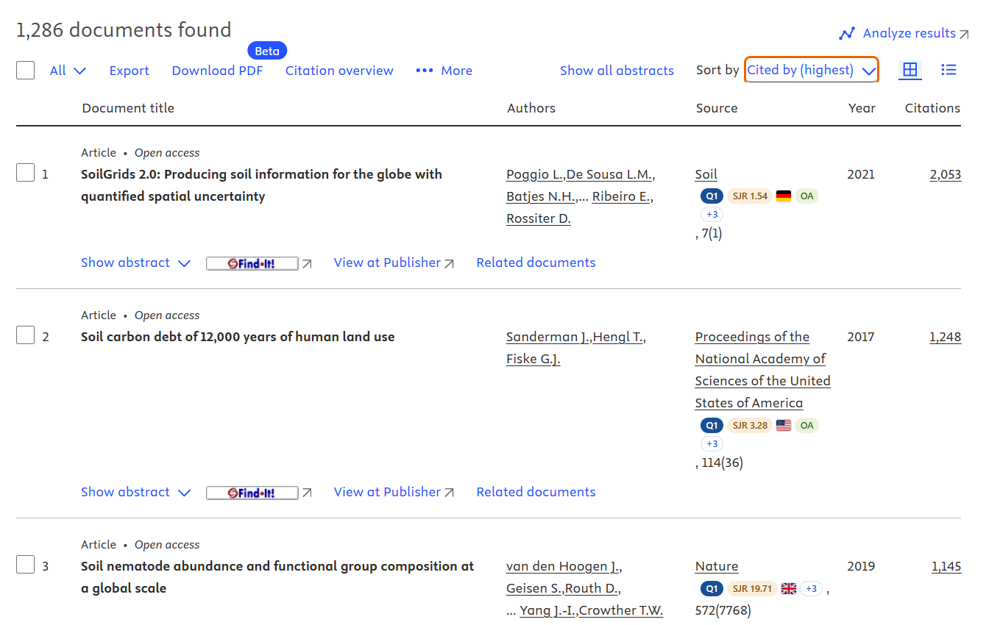
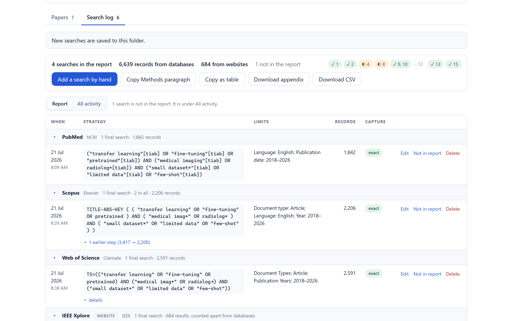
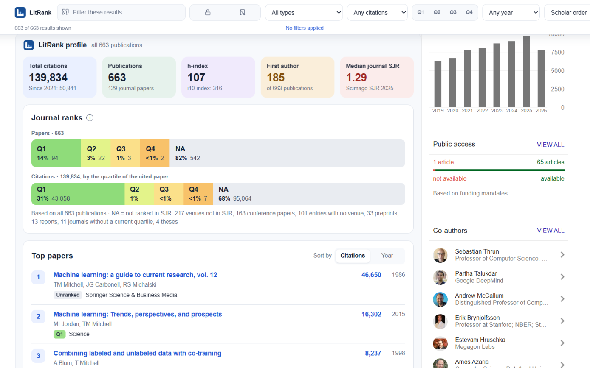

 

# LitRank: Literature Review for Google Scholar

**Journal quartiles and SJR scores on Google Scholar, Scopus and Web of Science, a search log for systematic reviews, and a one-click analysis of any Google Scholar profile.**

A free browser extension for Chrome, Firefox and Edge. No account. No tracking. Everything stays on your device.

 

### [**⬇ Chrome**](https://chromewebstore.google.com/detail/cfbmlenlhndbgojgikgoneolkbiajoab) &nbsp;·&nbsp; [**⬇ Firefox**](https://addons.mozilla.org/firefox/addon/litrank-google-scholar/) &nbsp;·&nbsp; [**⬇ Edge**](https://microsoftedge.microsoft.com/addons/detail/hcemdmhedfpjdjonnfeioodifjfciidm)

[Website](https://matily.org/litrank/) &nbsp;·&nbsp;
[What's new in 1.9.0](#whats-new-in-190) &nbsp;·&nbsp;
[FAQ](#frequently-asked-questions) &nbsp;·&nbsp;
[Report an issue](https://github.com/riponcm/LitRank/issues/new)

---

## What is LitRank?

LitRank is a free browser extension for researchers, PhD students and librarians. It does three things:

1. **Shows where a paper was published, and how that journal ranks.** Every Google Scholar result gets its journal's SJR quartile (Q1–Q4), SJR score, h-index, open-access status and country, plus the paper's citations per year. The same badges appear on Scopus, Web of Science, ScienceDirect and OpenAlex.
2. **Records your literature searches for a systematic or scoping review.** Turn the search log on for a database and LitRank keeps the exact query, filters, result count and date of every search, ready for the Methods section and PRISMA-S.
3. **Summarises any Google Scholar author profile** — citations, h-index, the journal quartiles of every paper, the citation trend and the most cited work — from the profile itself.

The ranking data is **Scimago Journal Rank (SJR) 2025**, covering over 31,000 ranked journals, with OpenAlex's 2-year citedness alongside. It ships inside the extension, so no lookup ever leaves your computer.

*This repository is LitRank's documentation, support and issue tracker.*

---

## What's new in 1.9.0

| | |
|---|---|
| **Search log for literature reviews** | Records the database, exact query, filters, result count and date of each search on 38 databases and publisher websites. Exports a Methods paragraph, a table, a search appendix or CSV, with a PRISMA-S checklist. |
| **Journal ranks beyond Google Scholar** | Quartile, SJR, country and open-access badges on Scopus, Web of Science, ScienceDirect and OpenAlex results. |
| **Google Scholar profile analysis** | Press *Analyse this author* for a page-wide summary: citations, h-index, first-author papers, median SJR, journal quartiles of papers and of their citations, citation trend, top papers, keywords and subject areas. |
| **Save from any publisher** | Right-click any article page, or press **Alt+Shift+L**, to save it into a folder; save the PDF you have open the same way. **Alt+Shift+K** logs the search on any results page. |
| **New name** | *LitRank: Literature Review for Google Scholar* — it now does more than quartiles. |
| **Changed** | PDFs are saved one at a time. Bulk PDF download is gone: publishers block whole universities for automated downloading. |

---

## Screenshots

### Journal quartiles on every Google Scholar result

Every result carries its journal's quartile, its citation rate and whether the journal has moved quartile. The bar above the page filters by quartile, document type, citation count and open access; the bookmark beside each title saves it to a folder.

### The same ranks on Scopus and Web of Science

Turn a database on in the library and its results get the same badges: here Scopus, with each journal's quartile, SJR score, country and open-access status under the source title. Web of Science, ScienceDirect and OpenAlex work the same way.

### A search log for your systematic review

Each search is recorded as you run it: the database, the query exactly as the database ran it, the limits, the number of records and the date. Refined searches stay linked to the search they narrowed, database and website searches are counted separately as PRISMA 2020 asks, and the checklist shows which PRISMA-S items are still missing.

### Analyse any Google Scholar profile

*Analyse this author* reads the whole profile, one page at a time as you would, and draws the summary above the publication list. It describes where the work appeared; it ranks no one against anyone. The profile shown is a public Google Scholar profile.

### A library that opens on your reading

Four figures and three charts, worked out from the papers you have saved. The Q1 share is measured against **ranked** papers only: an unranked venue means the journal could not be identified, not that the paper is poor.

### Folders you can export

Each folder has its quartile mix, median SJR, publication years and venues. Export it as BibTeX, CSV or JSON for Zotero, Mendeley or EndNote, or fill in missing details from Crossref.

The interface in every shot is the real extension. In the library, folder and search-log shots the papers and searches are invented, because a reading list is personal; the journals are real, so the quartiles and SJR figures are the genuine values LitRank looks up.

---

## Features

### Journal ranks

- **SJR quartile badge**, Q1 to Q4, with every subject category on hover
- **SJR score**, **h-index** and OpenAlex **2-year citedness**
- **Open access** and **DOAJ** indicators, and the **country** as a flag
- **Citations per year** — a 2004 paper with 400 citations is not outperforming a 2023 paper with 90
- **Document type**: journal article, conference paper, book chapter, preprint, thesis or report
- On **Google Scholar** results, author profiles and Scholar Labs, across its country domains; on **Scopus**, **Web of Science**, **ScienceDirect** and **OpenAlex** when you turn them on

### Filters Google Scholar does not have

| Filter | Why it matters |
|---|---|
| **Quartile** | Show only Q1 and Q2 journals |
| **Minimum citations** | Scholar sorts by citations but cannot filter by them |
| **Document type** | Exclude preprints, or show only journal articles |
| **Open access only** | Skip what you cannot read |
| **PDF available** | Only results with a direct PDF link |
| **Hide already saved** | On a second pass, see only what you have not triaged |
| **Sort by journal impact or citations** | Reorder without losing Scholar's own order |

### Search log (PRISMA-S)

- Off until you turn it on, one database at a time; your browser asks before LitRank reads each site
- Records the **query exactly as the database ran it** where the database shows it, and marks it *as typed* where it cannot
- Keeps **refinements** linked to the search they narrowed, and **re-runs** linked to the first run
- Counts **database** and **website** searches separately, as PRISMA 2020 asks
- Exports a **Methods paragraph**, a **table**, a **search appendix** or **CSV**
- **Imports the search history** pages of Web of Science, Scopus and ProQuest
- Works through your **university library proxy** (EZproxy-style addresses)
- On any other site: right-click its results page and choose **Log this search**, or press **Alt+Shift+K**

### Profile analysis

- Total citations, h-index and i10-index from Scholar's own figures
- **First-author** papers and the **median SJR** of the journals
- The share of **papers** and of **citations** in Q1, Q2, Q3, Q4 and unranked venues
- **Citations and papers per year**, over all years or the last five or ten
- **Top papers** by citations or by year, **research keywords** and **subject areas**

### Folders and export

- Save any Scholar result into a **named folder**; one paper can sit in several
- Save **any article page from any publisher** with a right-click or **Alt+Shift+L**
- Save a paper's **PDF** through your own library access, one file at a time
- Export **BibTeX**, **CSV** or **JSON**; **fetch missing metadata** from Crossref
- **Sync a folder** to a directory on your computer (Chrome and Edge)

---

## Supported databases and websites

The search log works on these 38 sites. Each is off until you turn it on.

| Databases | Publisher websites |
|---|---|
| Google Scholar · PubMed · Web of Science · Scopus · Embase · ProQuest · EBSCOhost · Cochrane Library · Engineering Village · CABI Digital Library · JSTOR · CNKI · DOAJ · TRID · Lens · OpenAlex · Semantic Scholar · Crossref · Europe PMC · arXiv · bioRxiv · medRxiv | ScienceDirect · SpringerLink · Nature.com · Wiley Online Library · Taylor & Francis Online · SAGE Journals · IEEE Xplore · MDPI · Frontiers · ACS Publications · ASCE Library · Science · Emerald Insight · Cambridge Core · Oxford Academic · Canadian Science Publishing |

Journal-rank badges appear on Google Scholar, Scopus, Web of Science, ScienceDirect and OpenAlex.

---

## How it works

Google Scholar and the databases print a journal name beside every result. LitRank matches that name — abbreviated, truncated or acronymised as the site leaves it — against the ranking data carried inside the extension, and draws the badge. No lookup leaves your machine.

The matching is deliberately conservative:

> **If more than one journal could fit, LitRank shows nothing rather than guessing.**

The search log follows the same rule. A search it cannot read exactly is marked as such, a count it cannot read is left blank rather than recorded as zero, and nothing is ever passed off as exact. A tool that quietly guesses is worse than one that admits the gap, because from the outside you cannot tell the two apart.

---

## Privacy

LitRank has **no server**, no account and no analytics.

- The ranking data is bundled in the extension and read locally
- Your papers, folders and search log live in your browser's storage
- The search log is off until you turn it on, and your browser asks before LitRank reads each site
- It never stores the articles a database returns — only what you searched for and how many results came back
- The only outbound request is to **Crossref**, and only when you press *Fetch metadata*

Full policy: [PRIVACY.md](PRIVACY.md)

---

## Frequently asked questions

### How do I see journal quartiles on Google Scholar?

Install LitRank and search Google Scholar as usual. Each result shows its journal's SJR quartile and score beside it; there is no account or setup.

### Where does the ranking data come from?

From **Scimago Journal Rank (SJR) 2025**, which Scimago computes from Scopus data, with 2-year citedness from **OpenAlex**. Over 31,000 journals carry a quartile. The data ships inside the extension.

### Does LitRank show the Journal Impact Factor?

No. LitRank shows **SJR** quartiles and scores, a different metric on a different scale from a different provider. The Journal Impact Factor is a Clarivate metric published in Journal Citation Reports, and its data cannot be redistributed in a free extension.

### How does LitRank help with PRISMA-S reporting?

It records each search's database, exact query, filters, result count and date as you run it, then exports a Methods paragraph and a search appendix and lists which PRISMA-S items are still missing. Database and website searches are counted separately, as PRISMA 2020 asks.

### Does the search log send my searches anywhere?

No. It reads the results page you are already looking at and keeps the record in your browser. It never runs searches, clicks or downloads for you.

### Which databases does the search log support?

38 databases and publisher websites, including Google Scholar, PubMed, Web of Science, Scopus, Embase, ProQuest, EBSCOhost and Cochrane Library — the [full list](#supported-databases-and-websites) is above. On any other site, right-click the results page and choose *Log this search*.

### Does it work with my university library login?

Yes. PDFs are saved through your own browser session, and the search log and badges work on databases reached through your library's proxy address once you add it in the library.

### What does the profile analysis show?

Total citations, h-index, i10-index, first-author papers, the median SJR of the journals, the share of papers and citations in each quartile, the citation trend, the most cited papers, keywords and subject areas. It is worked out in your browser from what the profile shows.

### Why does a journal show no badge, or "Unranked"?

Because it could not be identified exactly — usually an abbreviated name or one two journals share — or because the venue is not a ranked journal: preprints, theses and book chapters carry no quartile. It never means the journal scored badly.

### Can I use it with Zotero, Mendeley or EndNote?

Yes. Export BibTeX from any folder and import it. Records carry a DOI wherever one could be recovered.

### Is LitRank free?

Yes. There is no paid tier, no trial and no advertising, and none is planned.

### Is LitRank affiliated with Google, Clarivate or Elsevier?

No. LitRank is an independent extension. Google Scholar, Web of Science, Scopus, ScienceDirect and the other names mentioned are trademarks of their respective owners.

---

## Support

- **Found a bug or a wrong quartile?** [Open an issue](https://github.com/riponcm/LitRank/issues/new) with the journal name exactly as the page prints it, or the page address
- **Questions?** [Start a discussion](https://github.com/riponcm/LitRank/discussions)

---

## Contributing

The source is not public, but the work is not closed off.

**If you would like to contribute, [open an issue](https://github.com/riponcm/LitRank/issues/new) and say what you would like to work on.** That applies to code, and just as much to the things that are easy to overlook:

| You can help with | What that looks like |
|---|---|
| **Venue matching** | A journal that shows *Unranked* when it should not. Paste the venue exactly as the page prints it — that string is what the matcher works with. |
| **A wrong badge** | Far more serious than a missing one. LitRank is built to show nothing rather than guess, so a wrong quartile is a bug worth reporting immediately. |
| **A database that misreads** | A search the log recorded wrongly, or a results page it did not read. Tell us the database and what you saw. |
| **Translation** | The interface is English-only today. |
| **Accessibility** | Screen-reader behaviour, keyboard navigation, contrast. |
| **A feature you keep wishing for** | Especially if you can describe the moment in your own review where you wanted it. |

### If you find it useful

**⭐ Star the repository, and share it with someone starting a literature review.** Visible interest is what makes LitRank worth maintaining. A link passed to a lab group does more for this project than anything else on this page.

### Sponsorship

LitRank is **free, and stays free** — no paid tier, no upsell, no adverts, and nothing about your reading is ever sent anywhere. There is no revenue behind it.

**[Become a sponsor →](https://github.com/sponsors/riponcm)** — one-off or monthly, at whatever level makes sense for you or your institution. It goes to maintenance and to the yearly ranking-data rebuild.

Sponsorship buys no influence over what LitRank shows. Rankings are reported as they are; no journal, publisher or institution can pay to change a badge, and any offer to do so will be declined and made public.

---

## Acknowledgements

LitRank stands on work that other people gave away. Named here with thanks:

- **[Scimago Lab](https://www.scimagojr.com/)** — Scimago Journal Rank
- **[OpenAlex](https://openalex.org/)** — OurResearch
- **[Crossref](https://www.crossref.org/)**
- **[flag-icons](https://github.com/lipis/flag-icons)** — Panayiotis Lipiridis

Full licence terms for everything bundled with the extension are in the `NOTICE` file shipped inside it.

---

## Licence

The documentation in this repository is licensed **CC BY 4.0**.

The LitRank extension is **free to use, all rights reserved**: install it and use it for any purpose, but do not copy, modify or redistribute it. The terms are in the `LICENSE` file shipped inside the extension. Copies of earlier versions distributed under the GNU General Public License v3.0 remain under it.

Bundled third-party data keeps its own licence and is **not** covered by LitRank's — the terms travel with the extension in its `NOTICE` file. Some of it is non-commercial. LitRank is free and will remain free.

---

A product of **[Matily.org](https://matily.org/litrank/)**

