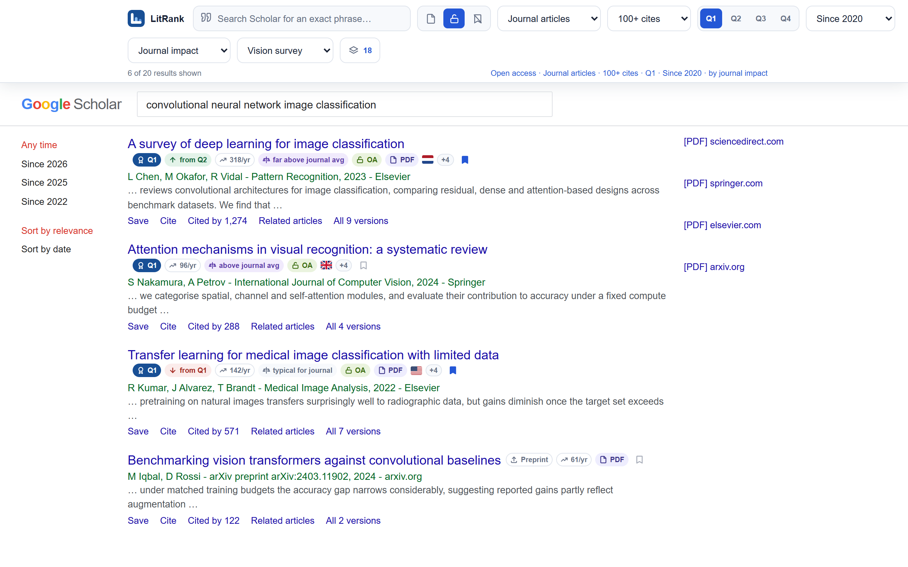
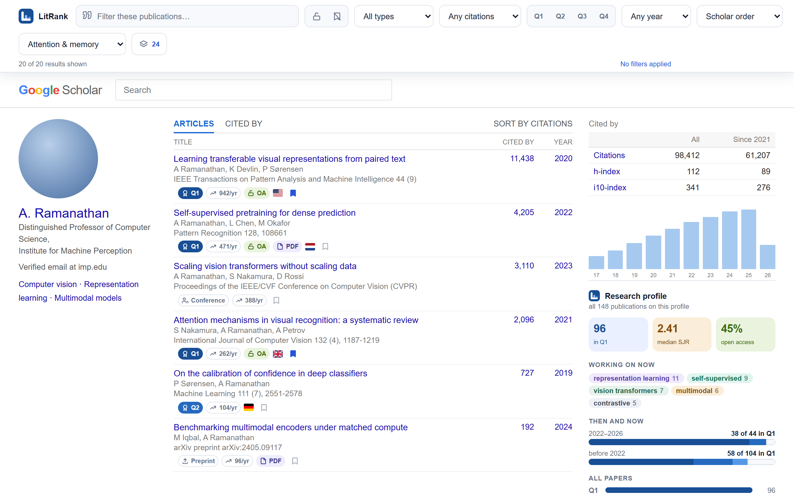
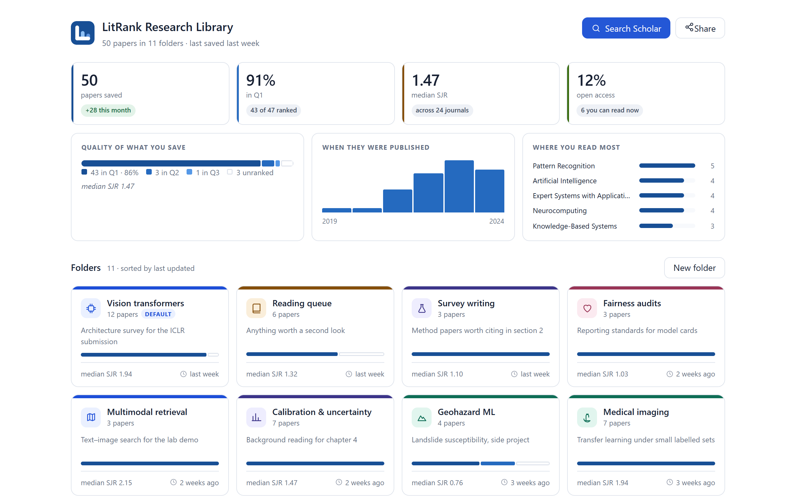
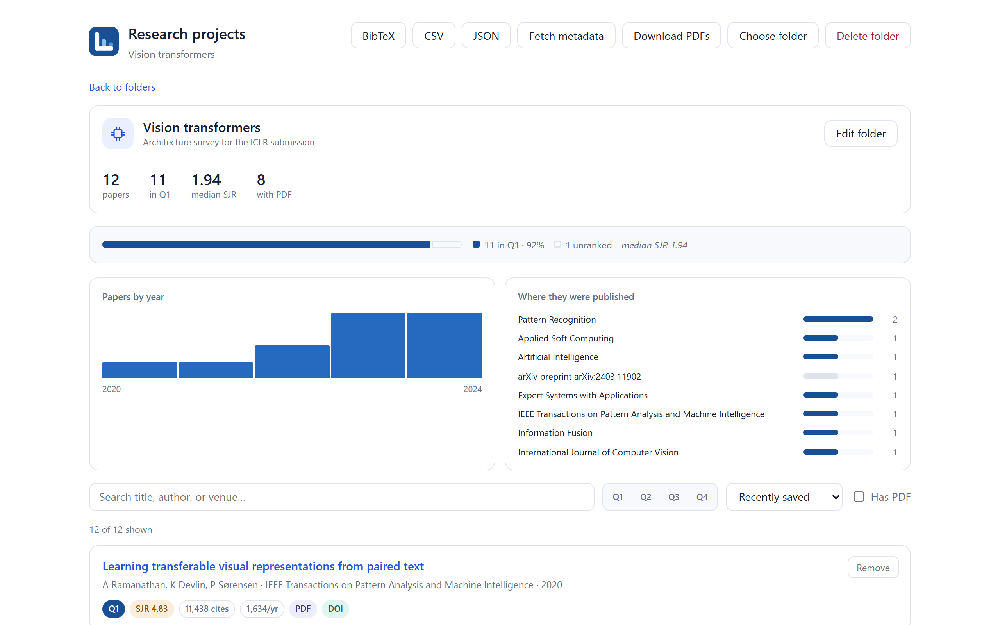

 

**See journal quality on Google Scholar, and turn a search into an organised library.**

Quartile badges, SJR metrics and open-access flags on every result — then save papers into folders and export BibTeX.
Works offline. No account. No tracking.

 

### [**⬇ Chrome**](https://chromewebstore.google.com/detail/cfbmlenlhndbgojgikgoneolkbiajoab) &nbsp;·&nbsp; [**⬇ Firefox**](https://addons.mozilla.org/firefox/addon/litrank-google-scholar/) &nbsp;·&nbsp; [**⬇ Edge**](https://microsoftedge.microsoft.com/addons/detail/hcemdmhedfpjdjonnfeioodifjfciidm)

Free forever &nbsp;·&nbsp;
[⭐ Star the repo](https://github.com/riponcm/LitRank) &nbsp;·&nbsp;
[Report an issue](https://github.com/riponcm/LitRank/issues/new)

## ✅ &nbsp;Out now on Chrome, Firefox and Edge

**The extension is real, and so are the numbers.** Every quartile and impact score in
the screenshots below was looked up from the actual ranking data the extension ships
with. The papers shown are invented — a reading list is personal — but the journals
they sit in are real, and so are their ranks.

 

*Source code follows shortly, under the GPL. This repository is the
documentation, support and issue tracker.*

---

## What is LitRank?

LitRank is a free browser extension that adds **journal quality information to Google Scholar search results** and lets you organise papers into folders.

Every result gets a badge showing its **SJR quartile (Q1–Q4)**, the journal's SJR score, open-access status, country of publication, and citations per year. You can then filter the page by quartile, document type, citation count or PDF availability — and save anything worth keeping into a named folder with BibTeX, CSV and PDF export.

Everything it needs ships **inside the extension**, so nothing about what you read is ever sent anywhere.

---

## Watch it work

**[▶ Watch the demo](https://www.youtube.com/watch?v=i3l-WhUpJoM)** — two minutes, no narration required.

---

## Screenshots

### Journal quartiles on every search result

Every result carries its quartile, its citation rate, whether the journal has moved up or down a quartile, and how the paper compares to others in the same journal. The **+** opens the rest — SJR, subject breadth, h-index, first indexed year — once, for the whole page.

The bar above the page filters by quartile, document type, citation count and open access, and the bookmark beside each title saves it to a folder.

### A quality profile for any author

The same badges appear on each publication — and the sidebar gains a **research profile card**. Press it and it reads every publication on the profile, not just the first page, then reports the quartile mix, median SJR, open-access share, what the author has been working on recently, how that compares with their earlier work, where they publish, how often they are first author, output per year, and their ten most cited papers.

It reads the profile the way you would, one page at a time. Nothing is sent anywhere.

### A dashboard that opens on your library

Four figures and three charts, all of it worked out from papers you have already saved — how much you keep, how much of it is Q1, the median SJR, how much you can read for free, and where your reading actually comes from.

The Q1 share is measured against **ranked** papers, not everything saved. An unranked venue means the journal could not be identified, not that the paper is poor, and counting those against you would be a quiet insult.

### Folders, not one flat reading list

Each folder carries its own colour, and the grid sorts by what you saved to most recently rather than by what you made first. Open one and you get its quartile mix, median SJR, a publication-year histogram and the venues you are actually citing — then export the lot as BibTeX, CSV or JSON, fetch missing metadata from Crossref, or sync it to a folder on disk.

A paper can sit in several folders at once. **My Research** is there from the first launch, so your first save always has somewhere to go.

The interface in every shot is the real extension. The papers and authors are invented — a reading list is personal, and the journals they sit in are real, so the quartiles and SJR figures shown are the genuine values LitRank looks up for those venues.

---

## Features

### On every Google Scholar result

- **Quartile badge** — Q1, Q2, Q3 or Q4
- **SJR score and h-index**, with the full subject-category breakdown on hover
- **Open access** and **DOAJ** indicators
- **Country of publication**, as a flag
- **Citations per year**, because a 2004 paper with 400 citations is not outperforming a 2023 paper with 90
- **Document type** — journal article, conference paper, book chapter, preprint, thesis or report

### Filters Google Scholar does not have

| Filter | Why it matters |
|---|---|
| **Quartile** | Show only Q1 and Q2 work |
| **Minimum citations** | Scholar sorts by citations but cannot filter by them |
| **Document type** | Exclude preprints, or show only journal articles |
| **Open access only** | Skip anything you cannot read |
| **PDF available** | Only results with a direct PDF link |
| **Hide already-saved** | On a second pass, see only what you have not triaged |
| **Sort by journal impact or citations** | Reorder without losing Scholar's own order |

### Folders

- Save any result into a **named folder** with its own icon, colour and description
- One paper can belong to **several folders** — no duplicates, no split metadata
- Per-folder **quartile distribution**, median SJR, publication-year histogram and top venues
- A **library summary** across everything you have saved, with a card you can share as an image — drawn on your machine, never uploaded
- Export **BibTeX**, **CSV** or **JSON**
- **Fetch full metadata** from Crossref to fill in volume, issue and pages
- **Sync to a folder** on your computer, or batch-download available PDFs

### Where it works

Google Scholar **search results**, **author profiles**, and **Scholar Labs** — plus 30+ country domains.

---

## How it works

Google Scholar prints a venue name beside every result. LitRank resolves that name — abbreviated, truncated or acronymised as Scholar leaves it — against ranking data carried inside the extension, and draws the badge. No lookup leaves your machine.

The matching is deliberately conservative, and the rule behind it is worth stating plainly:

> **If more than one journal could fit, LitRank shows nothing rather than guessing.**

An *Unranked* badge means the venue was not matched — **never** that it scored badly. A tool that quietly guesses is worse than one that admits the gap, because you cannot tell the two apart from the outside.

---

## Privacy

LitRank sends **nothing** as you browse.

- The entire ranking dataset is bundled in the extension and read locally
- Saved papers live in your browser's local storage — no server, no account
- No analytics, no telemetry, no tracking of any kind
- The only outbound request is to **Crossref**, and only when you press *Fetch metadata*

Full policy: [PRIVACY.md](PRIVACY.md)

---

## Frequently asked questions

### Does LitRank show the Journal Impact Factor?

No. LitRank shows **SJR (Scimago Journal Rank)**, which is a different metric on a different scale from a different provider. Journal Impact Factor is a Clarivate metric published in Journal Citation Reports, and its data cannot be redistributed in a free extension. Quartiles shown here are SJR quartiles.

### Why does a paper show "Unranked"?

Because the venue was not matched with confidence — not because it scored badly. The usual causes are that the venue is not a journal at all (preprints, theses and books carry no quartile), or that Scholar truncated the name past the point where it is still unique. The badge tells you which.

### Why do conference papers have no quartile?

Because quartiles are assigned to journals, not to proceedings — so LitRank shows a conference's SJR score and h-index instead of inventing a rank for it.

### Does it work on Google Scholar author profiles?

Yes. Profile pages get the same badges, plus a quality summary of the author's loaded publications — how many are Q1, the median SJR, and the distribution across quartiles.

### Does it slow Scholar down?

No. The ranking data is prepared once per page, off the critical path, and every lookup after that is instant.

### Is my reading list synced to the cloud?

No. Everything is stored locally in your browser. You can export it to a folder on your computer at any time, but nothing leaves your machine unless you ask it to.

### Can I use it with Zotero or Mendeley?

Yes — export BibTeX from any folder and import it. Records include a DOI wherever one could be recovered, so your reference manager can complete anything Scholar did not show.

### Is LitRank affiliated with Google?

No. LitRank is an independent extension. Google Scholar is a trademark of Google LLC.

---

## Support

- **Found a bug or have a request?** [Open an issue](https://github.com/riponcm/LitRank/issues/new)
- **Questions?** [Start a discussion](https://github.com/riponcm/LitRank/discussions)

---

## Contributing

The source is not public yet, so there is nothing to fork today — but the work is not closed off either.

**If you would like to contribute, [open an issue](https://github.com/riponcm/LitRank/issues/new) and say what you would like to work on.** We will get in touch and take it from there. That applies to code, but just as much to the things that are easy to overlook:

| You can help with | What that looks like |
|---|---|
| **Venue matching** | Tell us about a journal that shows *Unranked* when it should not. Paste the venue exactly as Google Scholar prints it — that string is what the matcher has to work with. |
| **A wrong badge** | Far more serious than a missing one. LitRank is built to show nothing rather than guess, so a wrong quartile is a bug worth reporting immediately. |
| **Translation** | The interface is English-only today. |
| **Accessibility** | Screen-reader behaviour, keyboard navigation, contrast. |
| **A feature you keep wishing for** | Especially if you can describe the moment in your own reading where you wanted it. |

Issues that describe a real workflow are more useful than a patch that arrives with no context, so do not hold back because you do not write JavaScript.

### If you find it useful

**⭐ Star the repository, and share it with someone whose reading list is a mess.** That is not a formality — the plan is to open-source LitRank under the GPL, and visible interest is what makes it worth maintaining in the open. A link passed to a lab group does more for this project than anything else on this page.

### Sponsorship

LitRank is **free, and stays free** — no paid tier, no upsell, no adverts, and nothing about your reading is ever sent anywhere. There is no revenue behind it.

**[Become a sponsor →](https://github.com/sponsors/riponcm)** — one-off or monthly, at whatever level makes sense for you or your institution. It goes to maintenance and to the yearly ranking-data rebuild.

Sponsorship buys no influence over what LitRank shows. Rankings are reported as they are; no journal, publisher or institution can pay to change a badge, and any offer to do so will be declined and made public.

---

## Acknowledgements

LitRank stands on work that other people gave away. Named here with thanks:

- **[Scimago Lab](https://www.scimagojr.com/)** — Scimago Journal Rank
- **[OpenAlex](https://openalex.org/)** — OurResearch
- **[Crossref](https://www.crossref.org/)**
- **[flag-icons](https://github.com/lipis/flag-icons)** — Panayiotis Lipiridis

Full licence terms for everything bundled with the extension are in the `NOTICE` file shipped inside it.

---

## Licence

The documentation in this repository is licensed **CC BY 4.0**.

The LitRank extension source is not yet public. It will be released under the **GNU General Public License v3.0**.

Bundled third-party data keeps its own licence and is **not** covered by that grant — the terms travel with the extension in its `NOTICE` file. Some of it is non-commercial. LitRank is free and will remain free.

---

A product of **[Matily.org](https://matily.org)**

